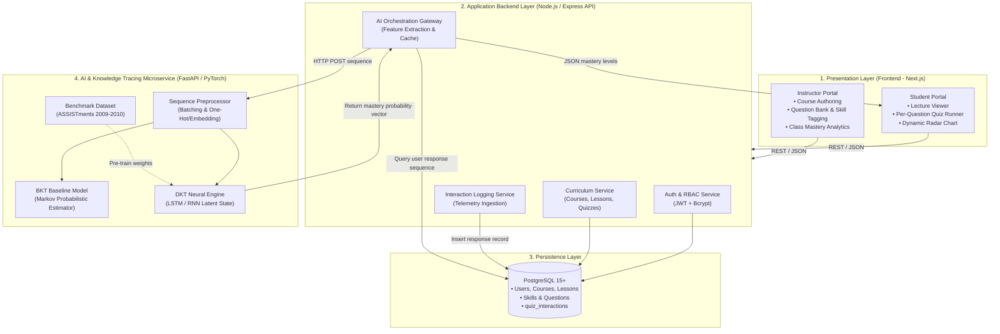
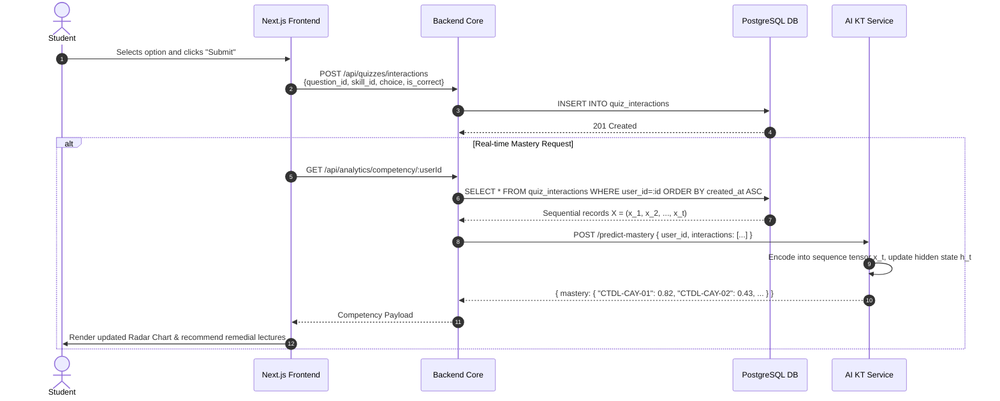

# OVERALL SYSTEM ARCHITECTURE & AI PIPELINE

> **System:** Adaptive E-Learning System with Integrated Knowledge Tracing  
> **Authors:** Nguyen Ngoc Sang (Lead), Nguyen Huu Hao, Pham Quang Tuan  
> **Advisor:** Dr. Nguyen Quoc Minh (Department of Artificial Intelligence, HCMUT CSE)  

---

## 1. High-Level Architecture (3-Tiered Architecture)

The system adopts a modular decoupled microservices architecture designed to support high-throughput interactive learning and asynchronous AI evaluation.

---

## 2. Telemetry and Knowledge Tracing Pipeline Flow

The end-to-end data flow operates in 5 deterministic stages:

---

## 3. Technology Stack Summary

| Component | Selected Technology | Rationale |
| :--- | :--- | :--- |
| **Frontend UI** | Next.js 14+ (React 18), Tailwind CSS | App Router architecture, responsive design, fast interactive rendering. |
| **Backend API** | Node.js (Express) / TypeScript | Lightweight asynchronous I/O, rapid JSON API development, JWT RBAC support. |
| **Database** | PostgreSQL 15 | Strict relational integrity, UUID generation, fast JSONB storage, composite time-series indexing. |
| **AI Service** | Python 3.10+, FastAPI, PyTorch | Industry standard for deep learning inference, async HTTP endpoints, NumPy/Pandas data manipulation. |
| **Containerization** | Docker, Docker Compose | Unified local development and reproducible production deployment. |

---

## 4. Architectural & System Design Diagrams

All diagrams have been created following academic UML standards and are provided in both **Draw.io source format** (`.drawio`) for live editing and **high-resolution PNG format** (`.png`) for report/slide embedding:

| Figure | Diagram Name | Draw.io Source File | Rendered PNG Image |
| :--- | :--- | :--- | :--- |
| **Figure 3.1** | **Overall UML Use Case Diagram** | [`01_use_case_diagram.drawio`](file:///c:/Users/PC/Documents/HCMUT/doanchuyennganh/Elearning-AI/docs/diagrams/01_use_case_diagram.drawio) | [`01_use_case_diagram.png`](file:///c:/Users/PC/Documents/HCMUT/doanchuyennganh/Elearning-AI/docs/diagrams/01_use_case_diagram.png) |
| **Figure 4.1** | **Decoupled 3-Tier System Architecture** | [`02_system_architecture.drawio`](file:///c:/Users/PC/Documents/HCMUT/doanchuyennganh/Elearning-AI/docs/diagrams/02_system_architecture.drawio) | [`02_system_architecture.png`](file:///c:/Users/PC/Documents/HCMUT/doanchuyennganh/Elearning-AI/docs/diagrams/02_system_architecture.png) |
| **Figure 4.2** | **UML Activity Diagram (Quiz & Telemetry)** | [`03_activity_diagram.drawio`](file:///c:/Users/PC/Documents/HCMUT/doanchuyennganh/Elearning-AI/docs/diagrams/03_activity_diagram.drawio) | [`03_activity_diagram.png`](file:///c:/Users/PC/Documents/HCMUT/doanchuyennganh/Elearning-AI/docs/diagrams/03_activity_diagram.png) |
| **Figure 5.1** | **DKT Mathematical Inference Pipeline** | [`04_ai_pipeline_diagram.drawio`](file:///c:/Users/PC/Documents/HCMUT/doanchuyennganh/Elearning-AI/docs/diagrams/04_ai_pipeline_diagram.drawio) | [`04_ai_pipeline_diagram.png`](file:///c:/Users/PC/Documents/HCMUT/doanchuyennganh/Elearning-AI/docs/diagrams/04_ai_pipeline_diagram.png) |
| **Figure 5.2** | **Relational Database Schema (ERD)** | [`schema.dbml`](file:///c:/Users/PC/Documents/HCMUT/doanchuyennganh/Elearning-AI/docs/database/schema.dbml) | [`05_erd_database.png`](file:///c:/Users/PC/Documents/HCMUT/doanchuyennganh/Elearning-AI/docs/diagrams/05_erd_database.png) |

