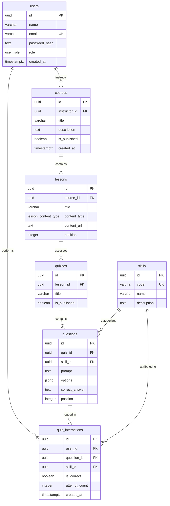

# DATABASE DATA DICTIONARY (E-LEARNING SYSTEM)

> **Database Engine:** PostgreSQL 15+ (with `pgcrypto` extension)  
> **Schema Designer:** Nguyen Huu Hao  
> **Topic:** E-Learning System with AI Knowledge Tracing  

---

## 1. Entity Relationship Overview
The relational database models core educational entities and provides high-resolution telemetry logging for the Knowledge Tracing AI engine.



---

## 2. Table Specifications

### 2.1. `users`
Stores system accounts with Role-Based Access Control (RBAC).
- `id` (UUID, PK): Auto-generated unique identifier (`gen_random_uuid()`).
- `name` (VARCHAR(120), NOT NULL): Full name of the user.
- `email` (VARCHAR(255), NOT NULL, UNIQUE): Institutional or personal email.
- `password_hash` (TEXT, NOT NULL): Encrypted password using Bcrypt/Argon2.
- `role` (ENUM: `'student'`, `'instructor'`, `'admin'`): Access control tier.
- `created_at`, `updated_at` (TIMESTAMPTZ).

### 2.2. `courses`
Represents an academic curriculum or subject.
- `id` (UUID, PK): Course identifier.
- `instructor_id` (UUID, FK -> `users.id`): Assigned instructor.
- `title` (VARCHAR(200), NOT NULL): Course title.
- `description` (TEXT): Syllabus summary.
- `is_published` (BOOLEAN, DEFAULT false): Visibility flag.

### 2.3. `lessons`
Individual learning modules under a course.
- `id` (UUID, PK): Lesson identifier.
- `course_id` (UUID, FK -> `courses.id`, ON DELETE CASCADE).
- `title` (VARCHAR(200), NOT NULL).
- `content_type` (ENUM: `'video'`, `'document'`, `'text'`).
- `content_url` (TEXT): Video stream URI or PDF storage path.
- `position` (INTEGER, NOT NULL): Ordinal index in the course structure.
- **Constraint:** `UNIQUE (course_id, position)` ensures strict lesson ordering.

### 2.4. `quizzes`
Assessment checkpoint associated with a lesson.
- `id` (UUID, PK): Quiz identifier.
- `lesson_id` (UUID, FK -> `lessons.id`, ON DELETE CASCADE).
- `title` (VARCHAR(200), NOT NULL).
- `is_published` (BOOLEAN).

### 2.5. `skills` (Knowledge Components - KCs)
Domain taxonomy nodes representing granular learning objectives.
- `id` (UUID, PK): Skill identifier.
- `code` (VARCHAR(80), NOT NULL, UNIQUE): Unique standard code (e.g., `CTDL-CAY-01`).
- `name` (VARCHAR(200), NOT NULL): Human-readable title (e.g., "Binary Search Tree Traversals").
- `description` (TEXT): Pedagogical scope.

### 2.6. `questions`
Multiple-choice questions linked to specific skills.
- `id` (UUID, PK): Question identifier.
- `quiz_id` (UUID, FK -> `quizzes.id`, ON DELETE CASCADE).
- `skill_id` (UUID, FK -> `skills.id`, ON DELETE RESTRICT).
- `prompt` (TEXT, NOT NULL): Question stem.
- `options` (JSONB, NOT NULL): Serialized array of choices `['A...', 'B...', 'C...', 'D...']`.
- `correct_answer` (TEXT, NOT NULL): Matching answer identifier.
- `position` (INTEGER, NOT NULL): Question sequence in the quiz.
- **Constraints:** `UNIQUE (quiz_id, position)`, `UNIQUE (id, skill_id)`.

### 2.7. `quiz_interactions` (Core Telemetry for Knowledge Tracing)
Captures every single response event in chronological order.
- `id` (UUID, PK): Record identifier.
- `user_id` (UUID, FK -> `users.id`, ON DELETE CASCADE).
- `question_id` (UUID, FK -> `questions.id`, ON DELETE CASCADE).
- `skill_id` (UUID, FK -> `skills.id`, ON DELETE RESTRICT).
- `is_correct` (BOOLEAN, NOT NULL): True if answer was correct ($a_t = 1$), false otherwise ($a_t = 0$).
- `attempt_count` (INTEGER, NOT NULL): Retake counter.
- `created_at` (TIMESTAMPTZ, NOT NULL DEFAULT now()): High-precision event timestamp.

### 2.8. Optimized Indexes
```sql
CREATE INDEX lessons_course_position_idx ON lessons(course_id, position);
CREATE INDEX questions_quiz_position_idx ON questions(quiz_id, position);
CREATE INDEX quiz_interactions_user_skill_time_idx ON quiz_interactions(user_id, skill_id, created_at DESC);
CREATE INDEX quiz_interactions_question_attempt_idx ON quiz_interactions(user_id, question_id, attempt_count DESC);
```
These composite indexes ensure $O(\log N)$ extraction speeds when building sequential student interaction histories $X_{1:t}$ for real-time model inference.
