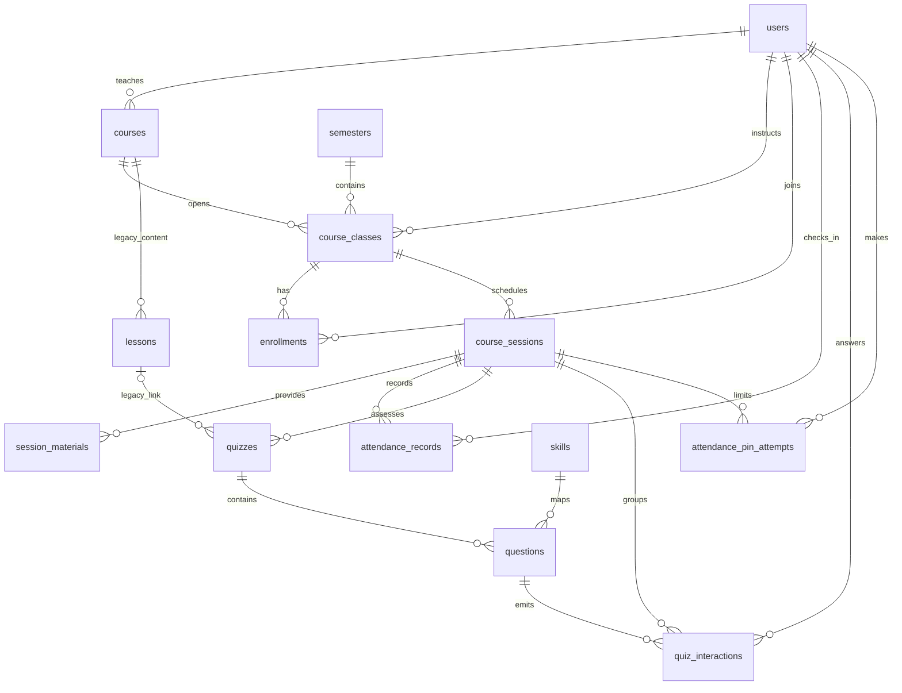

# Database Dictionary — E-Learning AI v2

**Engine:** PostgreSQL 15+ with `pgcrypto`. **Scope:** semesters, course offerings, schedules, learning materials, attendance, quizzes, and AI knowledge-tracing telemetry.

## Entity relationships

## Table specifications

### `users`

System accounts. `role` is `student`, `instructor`, or `admin`. Self-registration creates students; an administrator provisions staff roles. `password_hash` stores a bcrypt hash, never a clear-text password.

### `semesters`

| Field | Rule / meaning |
|---|---|
| `id` | UUID primary key |
| `code` | Unique short key, e.g. `HK261` |
| `name` | Display name, e.g. “Học kỳ 1 năm học 2026-2027” |
| `start_date`, `end_date` | Semester date range; start must be on or before end |
| `is_active` | Partial unique index permits at most one active semester |

### `courses`

Course catalog row. `instructor_id` refers to the course owner; `is_published` controls catalog visibility.

### `course_classes`

An actual course offering in a semester. `course_id` cascades when the course is deleted; `semester_id` and `instructor_id` use `RESTRICT`. `(semester_id, class_code)` is unique. `max_capacity` must be positive. A trigger locks the class row and rejects concurrent enrollment that exceeds capacity.

### `enrollments`

Maps a student to a class. `status` is `enrolled` or `dropped`; `UNIQUE (class_id, user_id)` allows a dropped student to re-enroll without erasing the original row. `final_grade` is nullable and, when present, must be 0–100. Class/user deletion cascades.

### `course_sessions`

Schedule rows numbered 1–15 per class (`UNIQUE (class_id, session_number)`). Each session has a date, start/end time, room, and temporary attendance state. End time must be later than start time. `class_id` cascades to sessions. The bulk API creates all 15 numbered sessions in one transaction.

Attendance fields:

- `attendance_code`: nullable four-digit PIN; present only while open.
- `is_attendance_open`: must agree with whether code and expiry are set.
- `attendance_expires_at`: timestamp after which check-in is rejected.

PINs use a cryptographic random-number generator. The opening API accepts a 10–15 minute duration (default 10), returns the code to the assigned instructor/admin only, and clears it on close/expiry. The server sweeps expired sessions every 15 seconds, and check-in also checks expiry directly.

### `session_materials`

Materials linked to a session. `material_type` is `slide`, `code`, or `video`; `(session_id, position)` sets display order. Deleting the session cascades.

### `attendance_records`

One row per student/session (`UNIQUE (session_id, user_id)`). `status` is `present`, `absent`, `late`, or `excused`; `method` is `pin`, `qr`, or `manual`. Present/late records require a timestamp and method. Session/user deletion cascades. Missing records count as not attended in the aggregate.

### `attendance_pin_attempts`

Records PIN validation attempts to limit guessing. Five failed attempts for one student/session within 15 minutes return HTTP 429. Attempts cascade with their session/user.

### `quizzes`

New quizzes require a `session_id`, so each assessment belongs to a class session. `lesson_id` remains nullable for v1 compatibility. Existing quizzes upgraded from v1 have a nullable session link until explicitly mapped; a not-valid check constraint preserves those rows while requiring new quizzes to link a session.

### `skills`

Knowledge Components; `code` is unique (example: `DSA-LINKEDLIST`).

### `questions`

Question prompt and JSONB options associated with a quiz and skill. `position` is unique within a quiz. `correct_answer` is a private server-side answer key; learner-facing quiz responses omit it. `(id, skill_id)` supports a composite FK that keeps telemetry skill attribution consistent.

### `quiz_interactions`

One response event per attempt: `user_id`, `session_id`, `question_id`, `skill_id`, `is_correct`, `attempt_count`, and `created_at`. The composite `(question_id, skill_id)` FK prevents the telemetry skill from diverging from its question. Historical v1 events retain a nullable `session_id`; a not-valid check constraint preserves those rows while requiring new events to include a session.

### `lessons` (legacy)

Retained for the original lesson API and historical quiz links. New quizzes are tied to `course_sessions`.

### `schema_version`

Records installed schema version; v2 inserts version `2` idempotently after its tables, constraints, and indexes.

## Delete behavior

- `course_classes → course_sessions → session_materials / attendance_records / quizzes / quiz_interactions / attendance_pin_attempts`: cascade.
- `course_classes → enrollments`: cascade.
- `users → enrollments / attendance_records / quiz_interactions / attendance_pin_attempts`: cascade.
- `courses → course_classes / lessons`: cascade.
- Semester and instructor references use `RESTRICT` to avoid orphaning active academic offerings.
- Skill references use `RESTRICT`; question/session deletion cascades through quiz interactions.

## Indexes

- Schedule: `(class_id, session_date, start_time)`.
- Attendance: unique `(session_id, user_id)` and lookup `(user_id, session_id)`.
- Enrollment counts: `(class_id, status)` and `(user_id, status)`.
- Session materials: `(session_id, position)`.
- Telemetry: `(user_id, skill_id, created_at)`, `(session_id, user_id, created_at)`, and `(user_id, question_id, attempt_count)`.
- Failed-PIN rate limit: `(session_id, user_id, attempted_at DESC)` for unsuccessful attempts.

## Attendance rate definition

Completed sessions are sessions whose scheduled end time has passed in `Asia/Ho_Chi_Minh`. `present` and `late` count as attended; `excused` sessions are removed from the denominator. Overall rate is attended check-ins divided by expected non-excused student/session occurrences. Missing records count as not attended.

## Upgrade from v1

Back up the database and run `psql -v ON_ERROR_STOP=1 -d <database> -f backend/db/schema.sql`. The script is rerunnable and adds new tables/columns without deleting existing data. V1 quizzes and quiz interactions receive nullable `session_id` fields so history is retained; map old quizzes to a class session before accepting v2 submissions for them.
